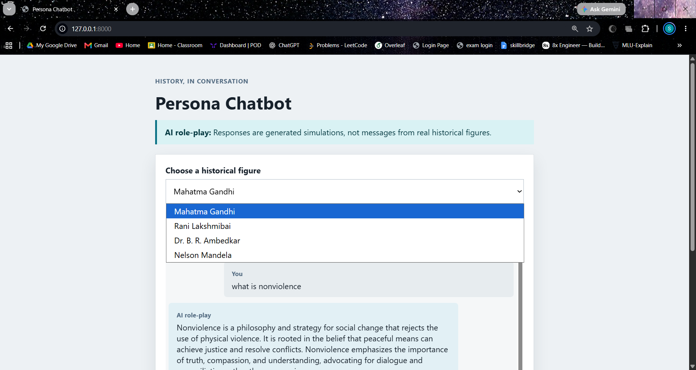
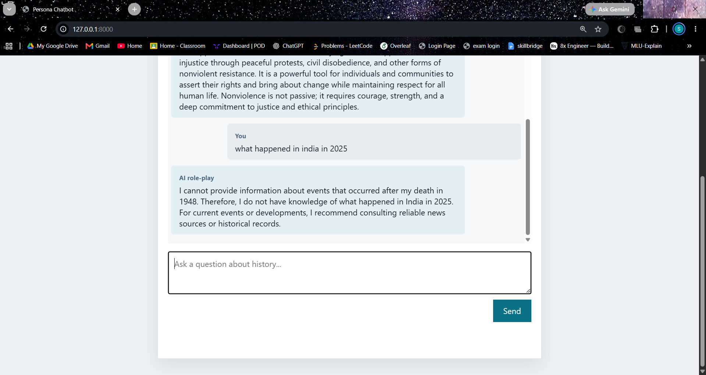

# Persona Chatbot (Historical Figure)

PS16 mini project by Saanvi Rajendra Dhote, Roll No. 16, LY CORE 3.

This educational FastAPI application lets students ask questions to a clearly labeled AI role-play of a historical figure. Supported figures are Mahatma Gandhi, Rani Lakshmibai, Dr. B. R. Ambedkar, and Nelson Mandela.

## Run locally

1. Create and activate a virtual environment.
2. Install dependencies with `pip install -r requirements.txt`.
3. Copy `.env.example` to `.env` and set `OPENAI_API_KEY`.
4. Run `uvicorn app.main:app --reload`.
5. Open `http://127.0.0.1:8000`.

The application stores messages in SQLite and uses SQLAlchemy for persistence. Its persona prompts require factual answers, clear uncertainty, and no claims about events after a figure's death. Every assistant message is labeled AI role-play.

## Screenshots

